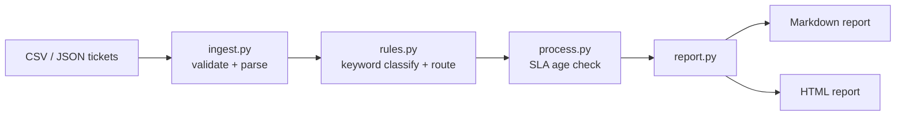

# Ticket Automation Toolkit

A small Python tool that ingests IT support tickets from CSV or JSON, classifies and routes them with keyword rules, flags SLA breach risk, and generates a weekly Markdown or HTML report.

> **All data is simulated.** The sample tickets in `data/` are made up. No real tickets, employer, or customer data are included, and no ticketing system is connected.

## Problem
Service desks spend time triaging by hand and often notice SLA breaches too late. This project automates the first-pass triage and gives a weekly summary.

## Architecture


- **Classification:** category with the most keyword hits wins; no hits goes to the `general` / Service Desk queue.
- **SLA:** P1 4h, P2 8h, P3 24h, P4 72h. `AT_RISK` at 75% of the SLA elapsed, `BREACHED` at 100%. Closed tickets are not flagged.
- Rules and SLA values live in `ticketkit/rules.py` and are easy to edit.

## Setup
Python 3.9+, standard library only (`pytest` for tests).
```bash
git clone https://github.com/AJJudkins/ticket-automation-toolkit
cd ticket-automation-toolkit
pip install pytest
```

## Usage
```bash
python -m ticketkit.cli data/sample_tickets.csv --now 2026-01-12T12:00            # print Markdown
python -m ticketkit.cli data/sample_tickets.json --out report.html                # HTML file
python -m pytest
```
Input fields: `id, created (ISO), priority (P1-P4), summary` plus optional `description, status`. `--now` fixes the reference time so output is reproducible.

## Sample output
Excerpt of `data/sample_report.md`:
```
**Total tickets:** 20
**Breached:** 2 | **At risk:** 0 | **OK:** 9 | **Closed:** 9

| ID | Pri | Queue | Age (h) | SLA (h) | Status | Summary |
| TKT-1004 | P3 | Application Support | 80.0 | 24 | BREACHED | Install design software |
| TKT-1006 | P2 | Desktop Support | 50.0 | 8 | BREACHED | Printer offline |
```

## What it demonstrates
- IT service management concepts: triage, routing queues, priorities, SLAs
- Input validation, a CLI, report generation, and tested business rules

## Limitations
Keyword matching only (no ML); no live ticketing integration; the HTML report is the Markdown in a `<pre>` block.

## License
MIT
